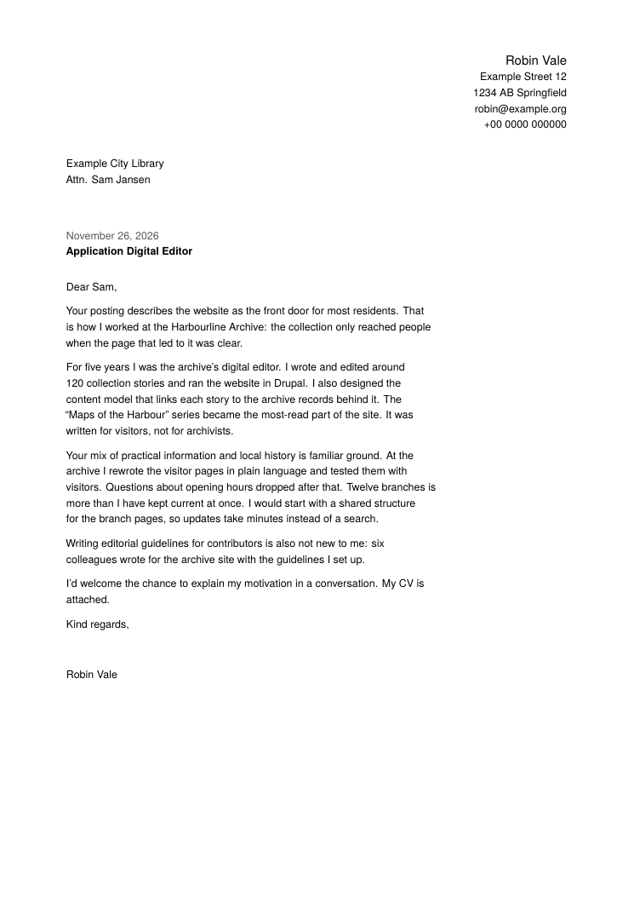
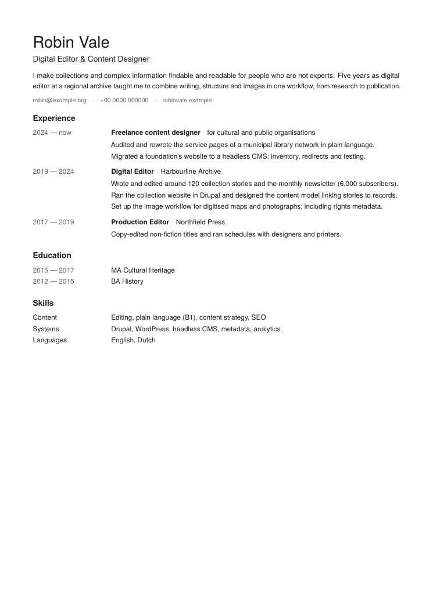

# Job application workflow

Job applications run as a repository: finding vacancies, judging them, writing
letters, building CVs and documents, tracking outcomes. Operated together with
an AI agent (built for [Claude Code](https://claude.com/claude-code)). Any
sector, any country, any language.

You make every decision; the agent does the reading, sorting, drafting and
typesetting. Everything it judges by is written down by you, and gets sharper
every time it gets something wrong.

It grew out of a year of one person's real search. The engine is generic. What
made it work was the profile: written-down evidence, claim limits, decision
rules and a style guide that every letter is held to.

## What sets it apart

- **Specific to you, not to a job title.** Vacancies are judged on what
  matters to you: the work itself, hours, salary, commute distance, sector.
  Hybrid roles go by a different title at every employer; judging the full
  text against your own rules still finds them.
- **Triage before scoring.** A cheap pass over the job cards rejects a title
  only when it breaks one of your explicit rules, and every rejection carries a
  rule code you can audit and reverse. Everything else is read in full and
  scored. You can search wide, pay little and miss less.
- **Prompts that improve with use.** Scoring, triage and letter rules are plain
  files in your profile. When the model gets something wrong, you write down
  why, and the next run knows. Letters that led to interviews become examples
  for the next one.
- **Private and public kept apart.** The engine is code only. Your profile,
  applications and history live in a separate workspace, so you can take
  updates and contribute fixes without untangling anything personal.
- **Multilingual.** Write each application in the language of the vacancy.
  Letters, CVs and documents hyphenate and date in that language; prompts and
  style rules are yours to write in whatever language you work in.
- **Your identity, typeset properly.** Letters, CVs and any other document
  (a proposal, a contract, meeting notes) come from your own LaTeX templates:
  one consistent personal or brand identity, print-quality PDFs, one page
  enforced where it matters, typography checked.

<table>
  <tr>
    <td></td>
    <td></td>
  </tr>
  <tr>
    <td align="center"><sub>Letter, from <code>examples/application/Example_Library</code></sub></td>
    <td align="center"><sub>CV, from <code>examples/profile/cv/content-editor.md</code></sub></td>
  </tr>
</table>

<sub>Built by <code>npm run build Example_Library</code> with the fictitious example profile. The design is a template in your profile; change it to anything LaTeX can do.</sub>

## One search, in numbers

The author's own search in the Netherlands, as of November 2026. Applications
since January; search state since April; sources tracked since August.

| | |
|---|---|
| Vacancies seen | 5,790 |
| Read in full and scored | 1,224 (432 scored 7/10 or higher) |
| Applications sent | 134 (52 still without an answer) |
| Invited to an interview | 18 |
| Browser search costs (Oct–Nov) | about $30 over 91 sessions |

Since August, by source:

| Source | Seen | Scored 7+ | Sent | Interviews |
|---|---|---|---|---|
| LinkedIn, public job pages | 628 | 177 | 21 | 3 |
| Indeed and LinkedIn in your own browser | 3,816 | 46 | 7 | 2 |
| Nationale Vacaturebank | 156 | 57 | 5 | 0 |
| A niche cultural job board | 498 | 12 | 2 | 0 |
| A commercial auto-matching service, for comparison | 176 | 41 | 9 | 1 |

The honest part: the automated search more than doubled the number of
applications, but not the number of interviews.

| Period | Sent | Interviews | Rejected | No answer yet | Interview rate (answered only) |
|---|---|---|---|---|---|
| Jan–Jun, before the search pipeline | 47 | 10 | 21 | 16 | 32% |
| Aug–Nov, with the search pipeline | 87 | 8 | 43 | 36 | 16% |

Some recent applications may still turn into interviews, and the market moved
in between. But the lesson stands: finding more is easy, and it is not the
bottleneck. What finding more buys you is choice. Spend it on fewer
applications, each one specific, rather than on more of them. That is why
the scoring and the letter rules matter more than the number of sources.

## What it does

```
find        chrome-search   Indeed + LinkedIn through your own logged-in browser
                            (Claude in Chrome), LinkedIn's public pages, any board
                            from community-portals, optional Nationale
                            Vacaturebank (NL), public ATS boards
sieve       triage          one cheap model call per 40 job cards: reject only on
                            explicit rules, calibrated by what you chose before
score       score           full text vs. your scoring prompt, home distance
                            check, duplicate check against earlier applications
review      y / n / later   nothing you haven't seen is ever consumed
evaluate    evaluate        a deeper fit analysis per vacancy
write       pack / draft    vacancy + research + CV + style rules + earlier letters
                            that led to interviews, for a chat or the API
build       build           letter and CV PDFs with your own LaTeX templates,
                            one page enforced, typography checked
track       submit/outcome  pending -> invited / rejected / withdrawn, or parked
document    doc             any markdown file -> PDF in your house style
                            (proposals, contracts, notes)
```

## Why search through your own browser

Keyword matching across aggregated feeds misses roles that don't have a clean
title. A hybrid role is a "web editor" at one employer and a "digital
coordinator" at the next. The search here uses your own search terms on the
platforms themselves, reads the full text and judges it against your rules.
It covers far fewer sources than an aggregator. For one person's search, the
results can be better.

## Job boards for your country

The built-in search covers Indeed and LinkedIn everywhere. For local boards,
it uses [community-portals](https://github.com/ai-job-search-dev/community-portals):
small command-line tools, one per job board, written and maintained by the
people who use them (Denmark, Brazil, Switzerland, the US and more, growing).
They all share one contract, so any of them plugs straight into the search
round, with the same triage, scoring and review as everything else.

```sh
git clone https://github.com/ai-job-search-dev/community-portals ../community-portals
# install Bun (https://bun.sh), then list the boards you want in
# <profile>/search/portals.json and add "portals" to search.platforms
npm run portals -- "web editor"     # check: each portal, a few results
```

Missing your board? Write a portal for it there; everyone using either project
benefits.

Boards and employers that publish an **RSS feed** need no portal: list the
feed in `<profile>/search/feeds.json` and it is read once per round, triaged on
its titles, and only what passes is opened for the full text. Check a site's
terms first: some forbid automated reading of their collection, and a portal
or feed should never work around that.

## Quick start

Requirements: Node 18+, Python 3.10+, [pandoc](https://pandoc.org) and a LaTeX
distribution with LuaLaTeX (TeX Live or MiKTeX), poppler-utils (`pdftotext`,
`pdfinfo`). For the browser search: Claude Code with the Claude in Chrome
extension.

```sh
git clone <this repo> && cd job-application-workflow
npm install
python -m venv venv && venv/bin/pip install -r requirements.txt   # Windows: venv\Scripts\pip
cp .env.example .env            # add your Anthropic API key

# Try it with the fictitious example profile:
mkdir -p active && cp -r examples/application/Example_Library active/
npm run build Example_Library   # -> active/Example_Library/outputs/*.pdf
```

Then make it yours. Keep everything personal in a **workspace** next to this
repo, so the two never mix:

```sh
mkdir ../my-applications
cp -r examples/profile ../my-applications/profile
echo "WORKSPACE_DIR=../my-applications" >> .env
cd ../my-applications && git init   # private: never push this anywhere public
```

```
job-application-workflow/     the engine: public, pull updates, send pull requests
my-applications/              yours: private repo
  profile/                    who you are, your rules, CVs, prompts, templates
  active/  submitted/  archive/   your applications and their history
  state/  output/             search state and built CVs (gitignore these)
```

Edit the profile in this order: `profile.json`, `PROFILE.md`, `warehouse.md`,
a CV variant in `cv/`, `STYLEGUIDE.md`, the prompts in `prompts/`, the search
terms in `search/queries.json`, and finally the templates (your look).

Without `WORKSPACE_DIR` it all lives inside this repo instead, gitignored. That
works, but the workspace is easier to back up and keeps your clone clean.

## A day with it

```sh
npm run chrome-search           # search round (costs a few browser sessions)
npm run score                   # score new finds, review them: y / n <reason> / l / o / d / s
npm run evaluate                # deep check of what you said yes to
npm run pack Example_Org        # paste into a chat, or: npm run draft Example_Org
npm run build Example_Org       # PDFs
npm run submit Example_Org      # after sending
npm run rank                    # deadlines first
```

Or simply ask the agent: "run a search round and show me what's worth reading".
`CLAUDE.md` tells it how the repository works.

## The profile

| File | Purpose |
|---|---|
| `PROFILE.md` | Who you are, the evidence, what you may and may not claim, what the search is for |
| `STYLEGUIDE.md` | Checkable rules for letters: structure, sentence length, banned phrases, fixed closing |
| `warehouse.md` | Every experience block in detail. Letters and CVs may only use what is here |
| `cv/` | CV variants, each one page, picked per vacancy |
| `prompts/scoring.md` | How a vacancy is scored, with calibration examples |
| `prompts/triage.md` | When a job card may be rejected on its title alone (rule codes) |
| `prompts/metadata.md` | Which CV variant fits which role; how to write the email hook |
| `search/queries.json` | Search terms per platform; quick, full and deep presets |
| `search/portals.json` | Which community-portals boards to search, with their flags |
| `search/feeds.json` | RSS feeds of job boards or employers |
| `templates/` | Your letter, CV and document design |
| `memory/` | What the agent should remember between sessions |

The scoring, triage and metadata prompts are where your judgement lives. Write
down every time the model gets it wrong, and why. A year of those notes is what
makes the scoring good.

## Costs

Scoring and triage use a small model (fractions of a cent per vacancy). Browser
sessions for Indeed cost more; `state/chrome_cost.log` records every session, so
you can tune batch sizes and models on real numbers. LinkedIn keyword searches,
LinkedIn job pages and Nationale Vacaturebank need no browser.

## Limits

- The browser search is tested on Indeed NL and LinkedIn. Indeed's page structure
  differs a little per country; the snippets in `scripts/prompts/` may need a tweak.
- Nothing applies, sends or submits on your behalf; you send applications
  yourself.

## Personal use only

This is a tool for one person's own job search, not for collecting data.
Several sources it can read say in their terms that they do not allow
automated access: LinkedIn, Indeed and Nationale Vacaturebank among them.
Using them here is your own decision and your own responsibility. Keep it
personal and low-volume: a few search rounds a week, at a human pace, only
the vacancies you might apply to, and never for resale, bulk collection or a
commercial service. Sources whose terms allow reuse (such as the Dutch
government boards, published under CC0) carry no such caveat. When you add a
board or a feed, read its terms first.

## Make it your own

Fork it, change it, build your own version: that's the point. A search in
another country, another profession or another language needs other search
sources, prompts and templates, and the engine is meant to be bent that way.

Because everything personal lives in your workspace, your fork holds only code.
That keeps two things easy:

- **Taking updates:** `git pull upstream main` never touches your profile or
  applications.
- **Giving back:** a fix or a new source in the engine can go straight into a
  pull request, with nothing private to untangle.

Contributions that are especially welcome:

- Search sources for other countries and job boards
- Example profiles for other professions (fictitious people only)
- Templates: other letter and CV designs
- Fixes when a platform changes its pages

Before opening a pull request, check the diff for anything personal: names,
addresses, real employers from your own search. Personal data belongs in the
workspace, never in the engine or `examples/`.

## License

MIT. Use it, change it, share it, sell it. Just keep the license file in your
copy.
